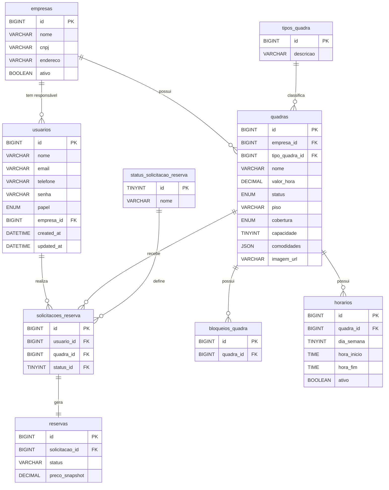

# bah_quadras_db

## Como criar o banco

**Banco novo (recomendado em desenvolvimento).** Apaga e recria o banco `bah_quadras` e o usuário `usr_app_bah_quadras`:

```
mysql -u root -p < bah_quadras_reset_completo.sql
```

Esse arquivo é gerado juntando os scripts abaixo. Sempre que alterar um script, gere de novo com `./gerar_completo.sh` (no Windows, pelo Git Bash).

**Banco já existente (criado antes da integração com a API).** Mantém os dados:

```
mysql -u root -p < migracoes/001_integracao_api.sql
mysql -u root -p bah_quadras < 05_triggers/01_trg_reserva_sem_conflito.sql
```

## Ordem de Execucao
1. 01_db, 02_users, 03_grants (como root)
2. 04_tables (em ordem numérica)
3. 05_triggers
4. 99_inserts (dados de desenvolvimento)

## Contas de desenvolvimento

Criadas por `99_inserts/05_usuarios.sql`. **Somente para desenvolvimento.**

| Papel | E-mail | Senha |
|---|---|---|
| admin | admin@bahquadras.com | admin123 |
| empresa (Arena Central) | contato@arenacentral.com | empresa123 |
| cliente | joao@arena.local / maria@arena.local | cliente123 |

O usuário da aplicação é `usr_app_bah_quadras` / `123456`, só com SELECT, INSERT, UPDATE e DELETE.

## Modelo Entidade Relacionamento


## Regras que o banco garante

- `usuarios.email` e `empresas.cnpj` são únicos.
- `horarios` é uma grade semanal: cada linha vale para toda semana naquele dia (`dia_semana` 0 = domingo ... 6 = sábado). Não pode haver dois slots começando na mesma hora na mesma quadra e dia; a sobreposição de períodos é validada pela API.
- O trigger `trg_reserva_sem_conflito` impede duas reservas `ATIVA` sobrepostas na mesma quadra e data.
- `reservas.preco_snapshot` guarda o `valor_hora` da época da reserva, para que mudar o preço da quadra não altere reservas já feitas.
